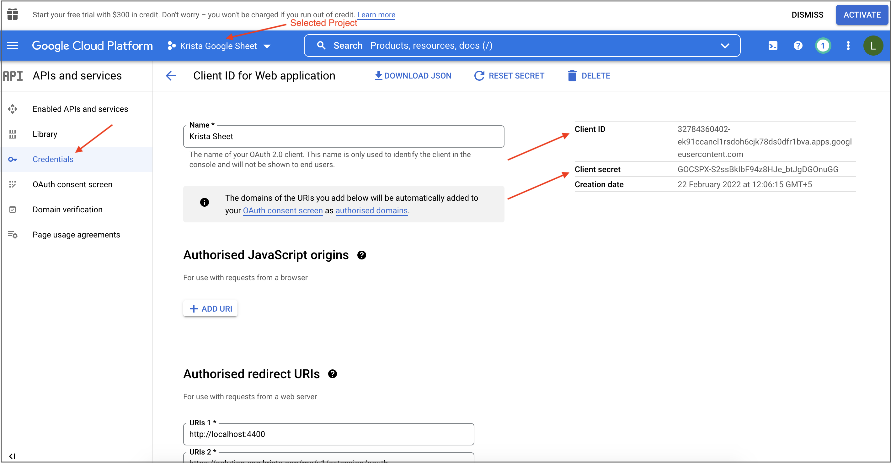
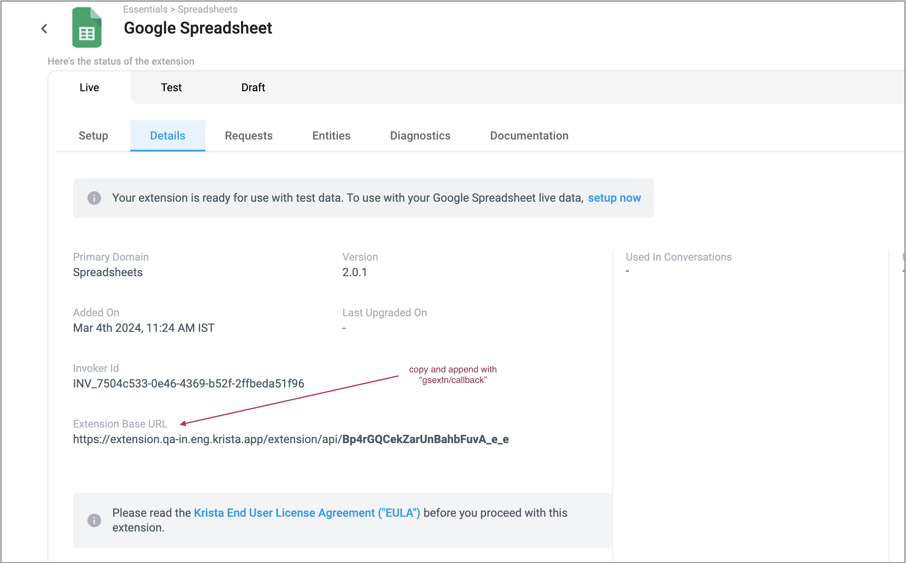
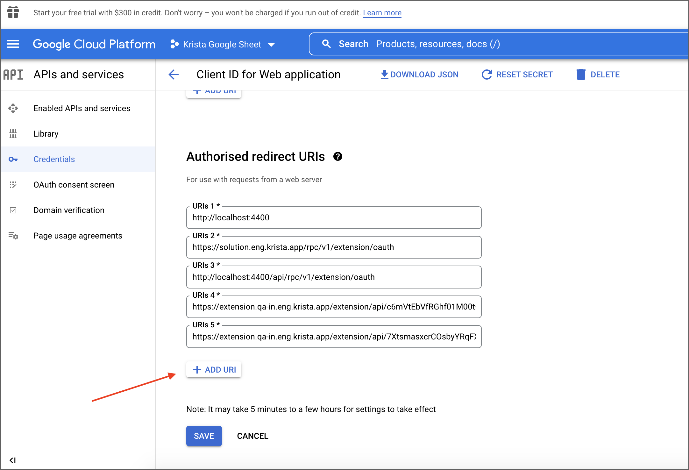

# Extension Configuration

## Overview

This guide explains how to configure the Google Spreadsheets Extension in your Krista environment. Proper configuration is essential for establishing secure connections to Google Sheets and enabling all extension features.

## Configuration Parameters

The following table lists all configuration parameters required for the extension:

| Parameter Name | Type | Required | Description | Example Value |
|---------------|------|----------|-------------|---------------|
| Client ID | Text | Yes | OAuth 2.0 Client ID from Google Cloud Console | `123456789-abc123.apps.googleusercontent.com` |
| Client Secret | Text (Secured) | Yes | OAuth 2.0 Client Secret from Google Cloud Console | `GOCSPX-abc123xyz789` |
| Email | Text | Yes | Google account email used for authentication | `user@example.com` |

## Step-by-Step Setup

### Step 1: Access Extension Setup

1. Navigate to the Krista Studio
2. Go to **Extensions** section
3. Locate **Google Spreadsheet** extension
4. Click on the extension to open its details page

### Step 2: Configure Client ID and Client Secret

1. In the extension setup page, locate the **Client ID** field
2. Enter your OAuth 2.0 Client ID from Google Cloud Console
   - This can be obtained from the **Credentials** tab in your Google Cloud project
   - See [Creating Google App](pages/CreatingGoogleApp.md) for detailed instructions

3. Locate the **Client Secret** field
4. Enter your OAuth 2.0 Client Secret
   - This is displayed alongside the Client ID in Google Cloud Console
   - The field is secured and will be encrypted



### Step 3: Configure Email

1. Enter the Google account email address that will be used for authentication
2. This should be the same email used to create the Google Cloud project
3. This email will be used for OAuth 2.0 authorization

### Step 4: Configure Redirect URI

The redirect URI is critical for OAuth 2.0 authentication flow:

1. **Get Extension Base URL**:
   - In the extension details page, locate the **Extension Base URL**
   - Example: `https://your-krista-instance.com/extensions/google-spreadsheet`

2. **Construct Redirect URI**:
   - Append `/gsextn/callback` to the Extension Base URL
   - Complete URI: `https://your-krista-instance.com/extensions/google-spreadsheet/gsextn/callback`

3. **Add to Google Cloud Console**:
   - Go to Google Cloud Console > APIs & Services > Credentials
   - Select your OAuth 2.0 Client ID
   - Under **Authorized redirect URIs**, click **Add URI**
   - Paste the complete redirect URI
   - Click **Save**





### Step 5: Save Configuration

1. Review all entered parameters
2. Click **Save** to store the configuration
3. The extension is now configured but not yet authorized

## Authentication Type Selection

The Google Spreadsheets Extension supports OAuth 2.0 user authentication:

### User Account Authentication

**When to Use**:
- Accessing user-specific spreadsheets
- Operations requiring user consent
- Interactive applications
- Development and testing

**Characteristics**:
- Requires user authorization through OAuth 2.0 flow
- Access token expires after 1 hour
- Refresh token used for automatic renewal
- User can revoke access at any time

**Setup**:
1. Configure Client ID and Client Secret (as described above)
2. Complete OAuth 2.0 authorization flow
3. See [Authentication](pages/Authentication.md) for detailed flow

## Redirect URI Configuration

### Understanding Redirect URIs

The redirect URI is where Google sends users after they authorize your application. It must:

- Be registered in Google Cloud Console
- Match exactly (including protocol, domain, path)
- Use HTTPS in production environments
- Point to the extension's callback endpoint

### Redirect URI Format

```
{Extension Base URL}/gsextn/callback
```

**Components**:
- `{Extension Base URL}`: Your Krista instance URL + extension path
- `/gsextn/callback`: Fixed callback path for this extension

### Common Redirect URI Issues

| Issue | Cause | Solution |
|-------|-------|----------|
| `redirect_uri_mismatch` error | URI not registered in Google Console | Add exact URI to Authorized redirect URIs |
| `redirect_uri_mismatch` error | Protocol mismatch (http vs https) | Ensure protocol matches exactly |
| Authorization fails silently | Incorrect callback path | Verify `/gsextn/callback` is appended correctly |

## Retry Mechanism

The extension includes an automatic retry mechanism for handling transient failures:

### Retry Configuration

- **Maximum Retry Attempts**: 3
- **Initial Delay**: 1 second
- **Maximum Delay**: 5 seconds
- **Backoff Strategy**: Exponential with jitter

### Retriable Errors

The following errors trigger automatic retry:

- Connection timeouts
- Socket timeouts
- HTTP 429 (Too Many Requests)
- HTTP 500 (Internal Server Error)
- HTTP 502 (Bad Gateway)
- HTTP 503 (Service Unavailable)
- HTTP 504 (Gateway Timeout)

### Non-Retriable Errors

The following errors do NOT trigger retry:

- HTTP 400 (Bad Request) - Invalid input
- HTTP 401 (Unauthorized) - Authentication required
- HTTP 403 (Forbidden) - Insufficient permissions
- HTTP 404 (Not Found) - Resource not found

### Retry Logging

Each retry attempt is logged with:
- Attempt number
- Error details
- Delay before next attempt
- Context information (spreadsheet ID, operation type)

Example log:
```
WARN: Google API request failed (attempt 1/3) - Connection timeout. Retrying in 1000ms - Context: Append cells to spreadsheet ABC123, sheet: Sheet1
```

## Security Considerations

### Credential Protection

⚠️ **Critical Security Practices**:

1. **Never Expose Credentials**:
   - Do not commit Client ID or Client Secret to version control
   - Do not log credentials in application logs
   - Do not share credentials via email or chat

2. **Use Secure Storage**:
   - Krista automatically encrypts Client Secret
   - Refresh tokens are stored securely
   - Access tokens are kept in memory only

3. **Rotate Credentials Periodically**:
   - Generate new Client Secret every 90 days
   - Update configuration with new credentials
   - Revoke old credentials after migration

### Access Control

1. **Principle of Least Privilege**:
   - Grant only required OAuth scopes
   - Limit spreadsheet access to necessary users
   - Review permissions regularly

2. **OAuth Scopes**:
   - `https://www.googleapis.com/auth/spreadsheets` - Full spreadsheet access
   - `https://www.googleapis.com/auth/drive` - Drive file access

3. **User Authorization**:
   - Users must explicitly authorize the extension
   - Authorization can be revoked at any time
   - Re-authorization required after revocation

### Network Security

1. **Use HTTPS**:
   - Always use HTTPS for redirect URIs in production
   - HTTP allowed only for localhost development

2. **Validate Redirect URIs**:
   - Register all redirect URIs in Google Console
   - Use exact matches (no wildcards)

## Troubleshooting

### Configuration Issues

**Problem**: "Invalid Client ID or Client Secret"

**Causes**:
- Incorrect credentials copied from Google Console
- Extra spaces or characters in credentials
- Credentials from wrong Google Cloud project

**Solutions**:
1. Verify credentials in Google Cloud Console
2. Copy credentials again, ensuring no extra spaces
3. Confirm you're using credentials from the correct project

---

**Problem**: "Redirect URI Mismatch"

**Causes**:
- Redirect URI not registered in Google Console
- Protocol mismatch (http vs https)
- Trailing slash mismatch

**Solutions**:
1. Copy exact Extension Base URL from Krista
2. Append `/gsextn/callback` exactly
3. Add complete URI to Google Console Authorized redirect URIs
4. Ensure protocol matches (https in production)

---

**Problem**: "Test Connection Failed"

**Causes**:
- Extension not authorized yet
- OAuth token expired
- Network connectivity issues

**Solutions**:
1. Complete OAuth authorization flow first
2. Execute a catalog request to trigger authorization
3. Check network connectivity to Google APIs
4. Verify firewall allows outbound HTTPS to googleapis.com

### Authorization Issues

**Problem**: "Authorization Required" when executing requests

**Cause**: User has not completed OAuth authorization flow

**Solution**:
1. Execute any catalog request in Krista client
2. Click on the authorization tab that appears
3. Sign in with Google account
4. Grant requested permissions
5. Wait for "User authenticated successfully" message

---

**Problem**: "Access Denied" errors

**Causes**:
- User doesn't have access to the spreadsheet
- Insufficient OAuth scopes
- Spreadsheet sharing settings

**Solutions**:
1. Verify user has edit access to the spreadsheet
2. Check spreadsheet sharing settings
3. Ensure OAuth scopes include spreadsheets and drive

## Validation

### Testing Your Configuration

After completing configuration, validate the setup:

1. **Test Connection**:
   - Click **Test Connection** button in extension setup
   - Should show "Connection successful" message

2. **Execute Test Request**:
   - Create a test spreadsheet in Google Sheets
   - Execute "Get Sheet Rows By Range" request
   - Verify data is retrieved successfully

3. **Check Authorization**:
   - Go to Google Account > Security > Third-party apps
   - Verify your Krista application is listed
   - Check granted permissions

### Configuration Checklist

- [ ] Client ID configured correctly
- [ ] Client Secret configured correctly
- [ ] Email configured correctly
- [ ] Redirect URI added to Google Console
- [ ] OAuth authorization completed
- [ ] Test connection successful
- [ ] Test request executed successfully

## Next Steps

After completing configuration:

1. **Complete Authentication**: Follow the [Authentication](pages/Authentication.md) guide
2. **Explore Catalog Requests**: Browse available operations in the sidebar
3. **Review Best Practices**: See individual request documentation for usage guidelines

## See Also

- [Authentication](pages/Authentication.md) - OAuth 2.0 authentication flow
- [Creating Google App](pages/CreatingGoogleApp.md) - Google Cloud Console setup
- [Home](/) - Extension overview and features

